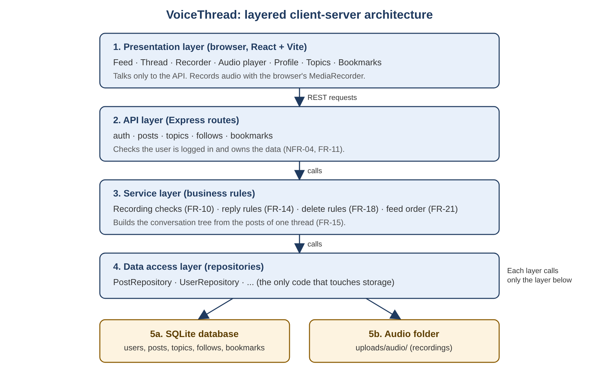

# Architecture Analysis Report

VoiceThread · Sprint 2 · Team deliverable (B1)

## 1. What the architecture must support

VoiceThread is an application which allows users to post voice messages and reply to them using voice responses so that the discussion forms a tree. The system architecture should satisfy the requirements of the application listed in `docs/requirements.md`.

| Driver | Source | What it means for the architecture |
|---|---|---|
All modifications are validated by teh server| NFR-04, FR-11 | Logins and ownership are validated before any modification or deletion. |
| Server-side validations | FR-10 | Duration (30 seconds to 5 minutes), file size (up to 10MB) and format (WebM, Ogg, MP4) are validated even though the client browser is not performing the validation. |
| Fast loading of a whole thread | FR-15, NFR-05 | Threaded tree is loaded in one query, thread containing 100 replies loads in less than 3 seconds on the demo laptop. |
| Saves are not partial | NFR-06, FR-24 | Audio file and corresponding row in the database table will be saved as a couple, without being partially saved. |
| Easy installation and maintenance | NFR-08 | New team member is installing and running the app according to the README file in less than 15 minutes. |
| Constraints of project | Course | Demo project in local environment with just one laptop, zero budget, 6 students and one semester. |

## 2. The styles compared

We compared three styles at the level of the whole application.

### 2.1 Layered client-server

The Three-Tier Client-Server Architecture divides systems into presentation, application, and data layers, increasing scalability, maintainability, and efficiency. By separating the concerns, this model optimizes resource management and allows for independent scaling and updates, making it a popular choice for complex distributed systems.

### 2.2 MVC

Over the last few years, websites have shifted from simple HTML pages with a bit of CSS to incredibly complex applications with thousands of developers working on them at the same time. To work with these complex web applications developers use different design patterns to lay out their projects, to make the code less complex and easier to work with. The most popular of these patterns is MVC also known as Model View Controller.

### 2.3 Microservices

Microservices is an architecture where an application is divided into small, independent services that communicate over a network. Each service handles a specific function and can be developed and deployed separately.

Services can be built using different programming languages and frameworks.
Each microservice is loosely coupled and can be developed, deployed, and scaled independently.

## 3. Comparison

| Criterion | Layered client-server | MVC | Microservices |
|---|---|---|---|
| Scalability | Scales using a larger machine. The repositories abstract away the storage, meaning that SQLite and the audio folder could be swapped out with PostgreSQL and cloud storage respectively without affecting the rest. Much more than a class demo requires. | The same as layered: one application, scaling as a whole. | Best. The audio service could scale separately. Much more than a local demo with few users requires. |
| Security | Single entry point (API). Authentication and authorization are done only once, in the API layer, for all requests (NFR-04, FR-11). | Checks are often done in individual controllers, meaning that one overlooked check opens a security flaw. | Greatest potential attack surface: every service requires its own protection and services need to trust each other. |
| Maintainability | Each layer does a single job and thus is testable on its own. The folder structure is structured according to the layers, hence, making it easy for new team members to locate the source code. | Very familiar and simple yet controllers become quite large and blend request handling with rules. | Services can evolve separately; however, one feature uses many services which makes debugging difficult and keeping data consistent across many services is difficult (NFR-06). |
| Team suitability (six students, one semester) | JavaScript throughout, one repository, one command to start application and the work separates naturally based on layers. Satisfies NFR-08. | Very easy to learn and very suitable with React and Express. | Infeasible. Many services to develop, deploy, start; setup in 15 min is unrealistic (NFR-08). |

## 4. Decision matrix

Each style is scored from 1 (poor) to 5 (excellent) on each criterion. Weights are based on requirement priorities: maintainability and team fit are the highest priorities due to NFR-08, team size, and the seasonality; security is an important aspect due to NFR-04; scalability is the lowest priority due to NFR-05 requirements and nature of the local demo application.

| Criterion | Weight | Layered client-server | MVC | Microservices |
|---|---|---|---|---|
| Scalability | 15% | 3 | 3 | 5 |
| Security | 25% | 4 | 3 | 2 |
| Maintainability | 30% | 5 | 4 | 2 |
| Team fit | 30% | 5 | 4 | 1 |
| **Weighted total** | 100% | **4.45** | **3.60** | **2.15** |

Example: layered scores 0.15 x 3 + 0.25 x 4 + 0.30 x 5 + 0.30 x 5 = 4.45.

**Does the result depend on the weights?** We also tested another totally different weighting where scalability was given 40%, while the other three were each given 20%. This resulted in the following totals: layered 4.0, MVC 3.4 and microservices 3.0. In this case, too, the layered client-server architecture prevails.

## 5. Final choice and justification

**We choose a layered client-server architecture**, as already described in section 2 of the design document.

| Layer | Responsibility | Examples |
|---|---|---|
| Presentation | Screens in the browser. It talks only to the API. | Feed, Thread, Recorder, Player, Profile, Topics, Bookmarks |
| API | Receives requests, checks that the user is logged in and owns the data. | auth, posts, topics, follows, bookmarks routes |
| Service | The business rules. | Recording checks (FR-10), reply rules (FR-14), delete rules (FR-18), feed order (FR-21) |
| Data access | Reads and writes storage. | PostRepository, UserRepository |
| Storage | Keeps the data. | SQLite database, audio folder |

Why it fits VoiceThread:

- **Security (NFR-04, FR-11):** the API layer is the only place where the check for login and ownership takes place, therefore an external request cannot circumvent it.
- **Validation (FR-10):** the recording rules exist once in the service layer and apply both to original postings and replies (US-04, US-07).
- **The conversation tree (US-08, FR-15):** the repository loads all the postings of a thread in a single query and the service layer constructs the tree and returns it to the browser.
- **Reliability (NFR-06, FR-24):** the service layer stores the audio file first and the database entry second, and deletes the file in case the second operation fails, which ensures that no reply is stored without its parent and audio is not orphaned.
- **The team and setup (NFR-08):** One language, one repository, one start command. The frontend, API and data access layers can be distributed among six developers without blocking each other.
## 6. Design patterns mapped to features

| Pattern | Feature | Where it appears |
|---|---|---|
| Repository | Loading and saving posts (FR-15, FR-24) | `PostRepository.getThread(rootId)` runs the single query on `root_post_id`, and `PostRepository.save(post)` stores a post. The services never write SQL, so the storage can change later. |
| Composite | The conversation tree and collapsing a branch (FR-15, FR-17) | A `TreeNode` holds a post and its replies. `collapse()` and `expand()` work the same way on a single reply and on a whole branch. |

The full mapping, with class sketches, is in `docs/architecture/patterns.md`.

## 7. Trade-offs we accept

- SQLite is single-writer and runs on a single machine. This will be sufficient for local demonstrations and we make no claims to scalability.
- Audio is stored in a folder on the disk without the use of a CDN and any kind of audio processing. The list of advanced features the team did not choose to implement includes both.
- Should the application have needed to support a large number of users, the replacement of the database would take place at the repository layer while the audio folder would be moved to cloud storage.
