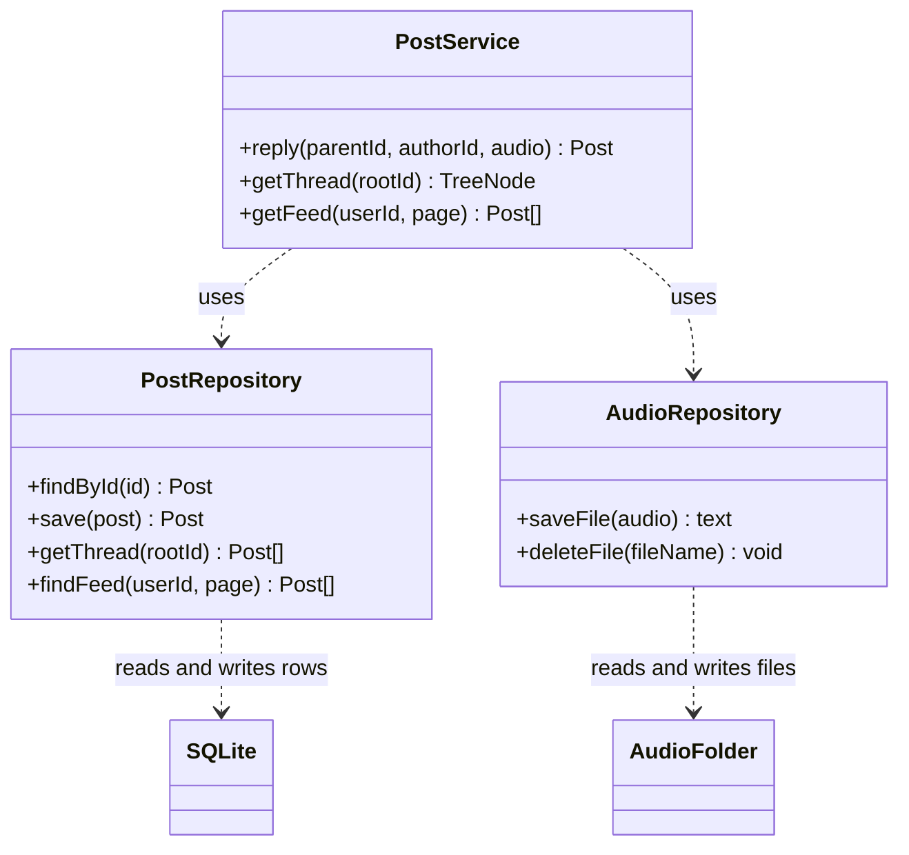
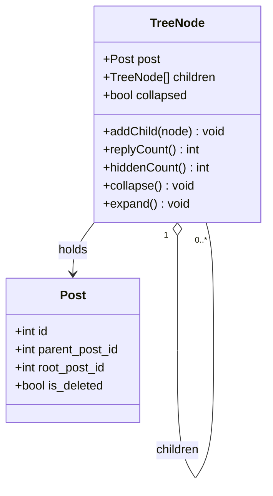

# Design Patterns in VoiceThread

This file explains the two design patterns that VoiceThread uses and the features each one serves. Every class and method name is the one in `docs/uml/class.md`. The patterns are also listed in section 6 of `docs/architecture/architecture-analysis.md`. This is the planned design. Nothing in it is built yet.

## Repository: loading and saving posts

- **Feature:** FR-15 (load a thread), FR-24 (data survives a restart). It also serves FR-19 (posts of a topic) and FR-21 (the Home feed).
- **User stories:** US-08 (see a conversation as a tree), US-10 (browse topics), US-11 (the Home feed) and, through FR-24, US-04 and US-07 (publishing and replying must survive a restart).
- **Problem:** The services hold the rules of the application, such as who may delete a post or how a reply is checked. If they also wrote SQL and touched the audio folder, the rules and the storage code would be mixed in every service. Changing the database would mean changing every service, and a rule could not be tested without a real database.
- **The pattern:** A repository is the only code that reads and writes one kind of data. The service asks for what it needs with a plain method call, and the repository decides how to get it.
- **How we use it:**
  - `PostRepository` is the only code that touches the posts table. Its methods are `findById(id)`, `save(post)`, `getThread(rootId)`, `findFeed(userId, page)`, `findByAuthor(userId)` and `findByTopic(topicId)`.
  - `AudioRepository` is the only code that touches the audio folder: `saveFile(audio)`, `deleteFile(fileName)` and `openFile(fileName)`.
  - `PostService` calls only these methods. It never writes SQL.
  - `PostRepository.getThread(rootId)` runs the single query on `root_post_id` that loads a whole conversation as a flat list of posts.

`SQLite` and `AudioFolder` in this diagram are the storage the repositories use, not classes in `class.md`.

- **Why it fits:**
  - The storage can change later without touching the rules. Only the repository would change if SQLite were replaced.
  - A service can be tested with a fake repository that holds a few posts in memory, with no database.
  - The thread query lives in one place, so FR-15 is loaded the same way everywhere.
  - Keeping `PostRepository` and `AudioRepository` apart lets `PostService` save the audio first and delete the file if saving the post fails, so a failed reply leaves no half-saved post and no unused audio file (NFR-06).
- **A note on fairness (FR-21):** `findFeed(userId, page)` is the only place that decides the order of the Home feed. It lists original posts, not replies, with those from followed users first and everyone else's after them, newest first in each group. There is no hidden score or ranking, and because the order is in one method, anyone can read it and check it.

## Composite: the conversation tree

- **Feature:** FR-15 (show the tree), FR-16 (what each post shows), FR-17 (collapse and expand a branch), FR-18 (a "post deleted" marker), FR-25 (the replies of a selected post are the children of its node).
- **User stories:** US-08 (see a conversation as a tree), US-09 (collapse, expand and move along branches) and US-05 (deleting a post keeps its replies in place).
- **Problem:** A conversation is a tree. A single reply and a whole branch of replies have to be treated the same way: both are drawn, both can be collapsed, and both need a count of the replies under them. Without a common type, every screen needs separate code for "a post" and "a group of posts", and a branch that is three levels deep needs a special case.
- **The pattern:** Composite. One type stands for both a single item and a group of items. Here, a node holds one post and a list of child nodes of the same type. A node with no children is a single reply, and a node with children is a branch.
- **How we use it:**
  - A `TreeNode` holds a `post`, a list of `children` (more `TreeNode` objects) and a `collapsed` flag.
  - `PostService.getThread(rootId)` gets the flat list of posts from `PostRepository.getThread(rootId)`, groups them under their `parent_post_id`, and returns the root `TreeNode`. It is sent to the browser as JSON.
  - In the browser, `collapse()` sets `collapsed` on a node, which hides everything below it, and `expand()` shows it again. Both work the same way on a single reply and on a whole branch.
  - `replyCount()` returns the number of direct replies, and `hiddenCount()` returns how many posts are hidden below a collapsed node (FR-17).
  - A deleted post stays in the tree as a node whose post has `is_deleted` set, drawn as a "post deleted" marker, and its children stay under it (FR-18).

- **Why it fits:**
  - Drawing the tree is one rule: draw a node, then draw its children the same way. It works at any depth, which is what FR-15 asks for.
  - Collapsing a branch needs no special case. It is `collapse()` on one node, and everything below it is hidden.
  - The database stores only flat rows with a `parent_post_id`. The tree is built from them in memory, so the stored data stays simple while the screen shows the full structure.
  - A deleted post is still a normal node, so its replies keep their place without any extra rule.

## How the two patterns work together

To show a thread, `PostService.getThread(rootId)` asks `PostRepository.getThread(rootId)` for the flat list of posts (Repository). It then builds the `TreeNode` tree from that list (Composite) and returns it. The browser draws the tree and collapses or expands branches without asking the server again.
