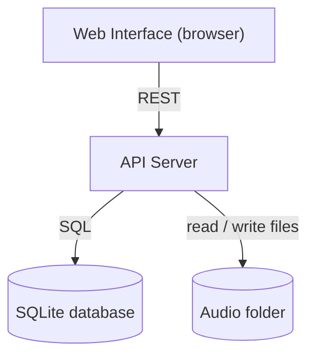
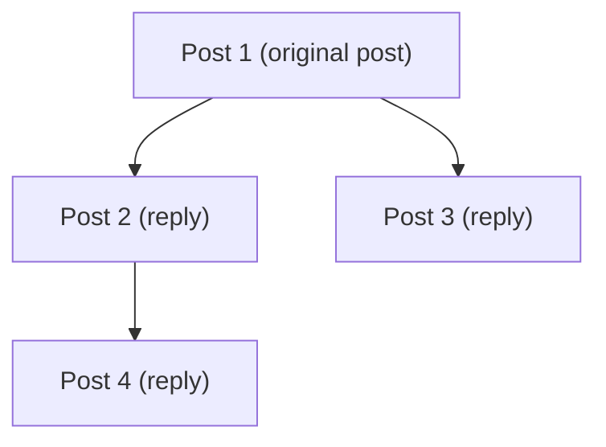

# VoiceThread — Initial Design

> **Status:** sections 1 to 7 written.
> **Owner:** Package 3 (sections 1 to 5). Package 4 adds the wireframe links in section 6. Amin adds the UML links in section 7.

## 1. Technology choice

| Part | Technology | Why |
|---|---|---|
| Interface | React, set up with Vite | The same parts, such as the audio player and a post in the tree, appear on many screens, so each one is written once and reused. React is free, well documented, and runs locally with two commands. The browser's built-in MediaRecorder handles recording and playback. |
| Server | Node.js with Express | One language (JavaScript) across the interface and the server, free, and small enough for six students to learn quickly. |
| Database | SQLite | A single file with no database server to install or run. It costs nothing and is enough for a local demo on one laptop. |
| Audio file storage | A normal folder on disk (`uploads/audio/`) | No cloud account and no cost. The database stores only the file name of each recording. |

These choices fit our limits: a local demo on a laptop, no budget, and a team of six students. Heavier options such as PostgreSQL or cloud audio storage would add setup and cost with no benefit at this scale.

## 2. High-level architecture

- **Web Interface:** where users record, play, reply and browse. It talks only to the API server.
- **API Server:** handles sign-in, original posts, replies, topics, follows, bookmarks and the Home feed. It also sends audio files to the browser.
- **SQLite database:** stores all data except the audio itself, including the links that form the conversation tree.
- **Audio folder:** holds the recorded audio files. The database stores each file's name.

## 3. Main data

| Item | Key fields | Notes |
|---|---|---|
| **User** | id, username, email, password_hash, display_name, photo, bio, created_at | One row per account. Email and password are used to sign up and log in. Only the password hash is stored, never the password. |
| **Topic** | id, name | A subject that original posts are filed under. |
| **Post** | id, author_id, parent_post_id, root_post_id, title, description, audio_file, duration_seconds, created_at, is_deleted | One recording, either an original post or a reply. `is_deleted` marks a deleted post. |
| **PostTopic** | post_id, topic_id | Links an original post to its topics. Each original post has 1 to 3 rows. |
| **Follow** | follower_id, followed_user_id, created_at | Which user follows which user. |
| **Bookmark** | user_id, post_id, created_at | A post a user has saved. |

## 4. How the conversation tree is stored

Every post has a `parent_post_id` column.

- An **original post** has `parent_post_id = NULL`.
- A **reply** stores the `id` of the post it answers in `parent_post_id`.
- Every post also stores `root_post_id`, the id of the original post of its conversation, so a whole conversation can be loaded with one query.

| id | root_post_id | parent_post_id | meaning |
|---|---|---|---|
| 1 | 1 | NULL | Original post |
| 2 | 1 | 1 | Reply to post 1 |
| 3 | 1 | 1 | Another reply to post 1 |
| 4 | 1 | 2 | Reply to post 2 |

To show a conversation, the server runs `SELECT * FROM posts WHERE root_post_id = 1`, and the app builds the tree in memory by grouping posts under their `parent_post_id`. This is called an adjacency list: simple to write and easy to understand.

**Deleting a post (FR-18).** A deleted post that has replies becomes a "post deleted" marker (`is_deleted = 1`). Its replies stay in place, because their `parent_post_id` still points to it.

## 5. Main operations

- Sign up, log in, log out and edit your profile.
- Create an original post (audio, title, description, 1 to 3 topics).
- Reply to a post.
- Load a conversation as a tree.
- Play a post's audio.
- Delete a post (see section 4 for what happens to its replies).
- Browse topics and view the posts in a topic.
- Follow and unfollow a user.
- Load the Home feed.
- Bookmark and unbookmark a post, and view your bookmarks.
- Open a post through its share link.

## 6. Wireframes

- Figma file: https://www.figma.com/design/CKYiVGtwJllHe7USKXzevC/Wireframes
- Images and notes: [docs/wireframes/](wireframes/)

## 7. UML diagrams

Use case, class and sequence diagrams: [docs/uml/](uml/)
