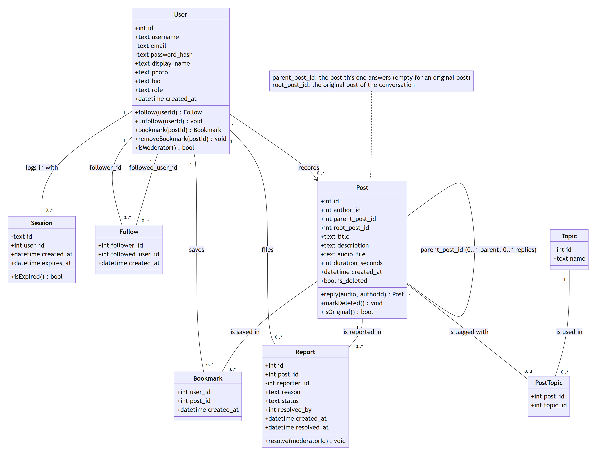
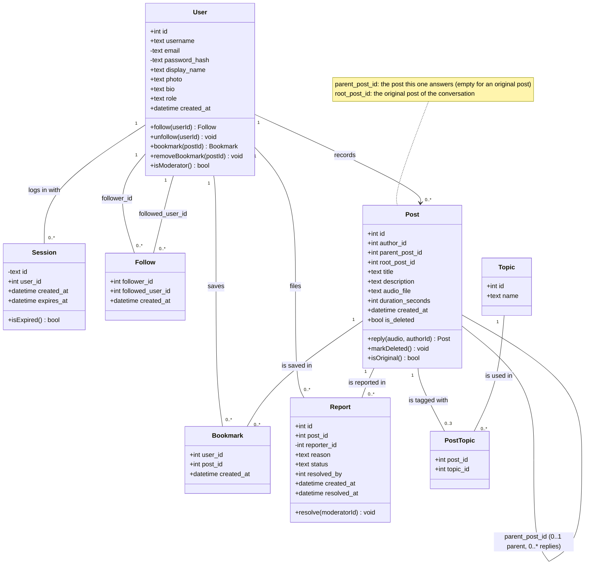
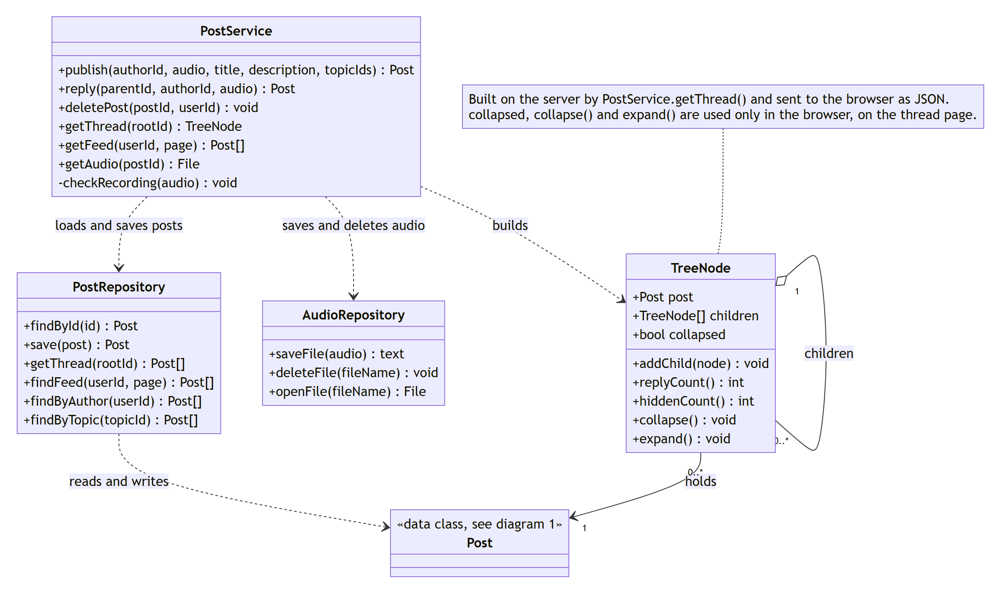
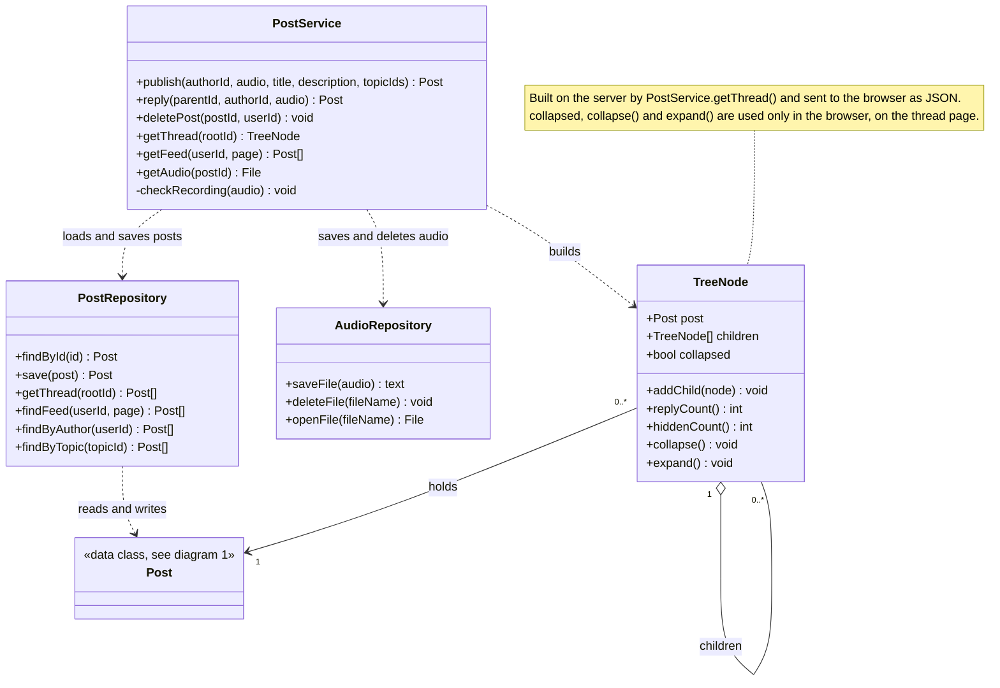
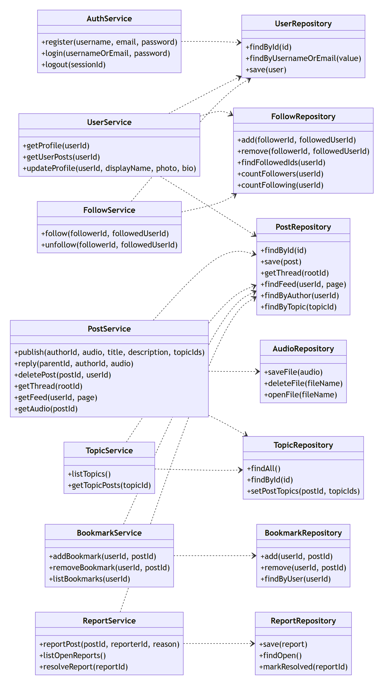
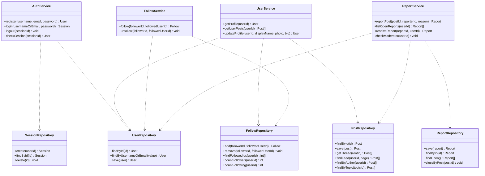
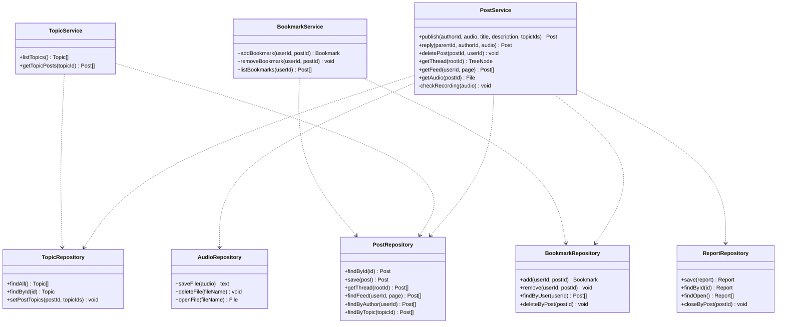

# Class diagram

This file has three class diagrams:

1. The data VoiceThread stores, and how the pieces link.
2. Posts and the conversation tree: the classes that load a conversation and build it into a tree.
3. The services and repositories on the API server, with the names the component diagram (`component.md`) and the sequence diagrams use.

The data classes and their fields are the tables in section 3 of `docs/design.md`, with the same names. The types are the simple kinds of value each field holds. The exact SQLite column types are chosen when the database is built (backlog item B-01).

`+` means public and `-` means private. Every method shows what it returns, and `void` means it returns nothing. A class that appears in more than one diagram has exactly the same fields and methods in each. This is the planned design. Nothing in it is built yet.

## 1. Stored data

## 2. Posts and the conversation tree

## 3. Services and repositories

The API server has one service for each route group in the component diagram, and one repository for each kind of stored data. A service holds the rules and only talks to repositories. A repository is the only place that reads or writes its table or folder. The dashed arrows mean "uses".

The services are split over two diagrams so that every line runs straight from a service to a repository. A repository used by both groups, such as PostRepository, appears in both.

### 3a. Accounts, following and reports

### 3b. Posts, topics and bookmarks

## The classes

| Class | What it is | Key | Rules from the requirements |
|---|---|---|---|
| User | One account | `id` | `username` and `email` are unique (FR-01). The password is at least 8 characters and only its hash is stored (FR-01, NFR-04). `email` and `password_hash` are private (see Privacy below). `role` is `member` for everyone, or `moderator` for the team members who review reports. It is set by a setup script, so there is no screen for changing it. |
| Session | One logged-in browser | `id` | Created when a user logs in and deleted when they log out (FR-02, FR-03). The `id` is a long random value kept in a cookie in the browser, so the user stays logged in after a refresh or reopening the browser until they log out or the session expires (FR-02). |
| Post | One recording: an original post or a reply | `id` | An original post has a title and 1 to 3 topics, and its description is optional. A reply has no title or topics (FR-09). Every recording is 30 seconds to 5 minutes, at most 10 MB, and WebM, Ogg or MP4 audio (FR-10). `audio_file` is the file name in the audio folder (design section 1). |
| Topic | A subject from the fixed list | `id` | Users pick topics from the list and cannot add new ones (FR-19). |
| PostTopic | Links an original post to one of its topics | `post_id` and `topic_id` together | An original post has 1 to 3 rows and a reply has none (FR-09). |
| Follow | One user following another | `follower_id` and `followed_user_id` together | A user cannot follow themselves, so the two ids are never equal (FR-20). |
| Bookmark | A post a user has saved | `user_id` and `post_id` together | Only the user who saved it can see or remove it (FR-22, US-12). |
| Report | One user reporting one post, for the team to review by hand | `id` | Stores what the `/reports` route receives. `reason` is the user's written reason, and `status` is `open` until a moderator handles it, then `resolved`, with `resolved_by` and `resolved_at` set. `id` is the report's ticket number. Reporting is a Sprint 3 extra (backlog B-20), not a core FR. |
| TreeNode | One post in a loaded conversation, with the replies under it | (not stored) | See "Where TreeNode lives" below. This is the Composite pattern in `docs/architecture/patterns.md` (FR-15, FR-17). |
| Services | The rules on the server, one per route group | (not stored) | They check the rules before anything is saved, for example the recording rules (FR-10), that only the author can delete a post (FR-11), and that only moderators handle reports. |
| Repositories | The only classes that read or write a table or the audio folder | (not stored) | This is the Repository pattern in `docs/architecture/patterns.md`. |

## The methods

The methods on the data classes say what each kind of object can do. On the server, a service carries the action out and saves the result through a repository.

| Method | What it does | Requirement |
|---|---|---|
| `User.follow(userId)` | Follows another user. Refused if `userId` is the user's own id. | FR-20 |
| `User.unfollow(userId)` | Stops following a user. | FR-20 |
| `User.bookmark(postId)` | Saves a post to the user's private bookmarks. | FR-22 |
| `User.removeBookmark(postId)` | Removes a bookmark. | FR-22 |
| `User.isModerator()` | True when `role` is `moderator`. | B-20 (extra) |
| `Session.isExpired()` | True once `expires_at` has passed, so the user has to log in again. | FR-02 |
| `Post.reply(audio, authorId)` | Creates a reply with `parent_post_id` set to this post and `root_post_id` set to this post's root. Refused if this post has been deleted. | FR-14 |
| `Post.markDeleted()` | Only sets `is_deleted`. Everything else about deleting is done by `PostService.deletePost` (see "Deleting a post"). | FR-18 |
| `Post.isOriginal()` | True when `parent_post_id` is empty, so the post starts a conversation. | FR-09, FR-21 |
| `Report.resolve(moderatorId)` | Sets `status` to `resolved` and records who resolved it and when. | B-20 (extra) |
| `TreeNode.addChild(node)` | Puts a reply under the post it answers while the tree is built. | FR-15 |
| `TreeNode.replyCount()` | Counts the direct replies, shown on each post. | FR-16 |
| `TreeNode.hiddenCount()` | Counts every reply under this post, shown when the branch is collapsed. | FR-17 |
| `TreeNode.collapse()` and `TreeNode.expand()` | Hide and show the replies under this post. | FR-17 |
| `AuthService.login(...)` | Checks the password against the hash and creates a Session. | FR-02 |
| `AuthService.logout(sessionId)` | Deletes the Session, so the cookie no longer works. | FR-03 |
| `AuthService.checkSession(sessionId)` | Used by the auth check in the component diagram before every change and every private page. Returns the logged-in user, or refuses if the session is missing or expired. | FR-03, NFR-04 |
| `PostService.publish(...)` and `PostService.reply(...)` | Check the recording with `checkRecording` before saving it. | FR-09, FR-10, FR-14 |
| `PostService.getThread(rootId)` | Loads the posts through `PostRepository.getThread` in one query and builds them into `TreeNode`s. | FR-15 |
| `PostService.deletePost(postId, userId)` | Refuses unless `userId` is the author, then deletes the post as described below. | FR-11, FR-18 |
| `PostService.getAudio(postId)` | Opens the audio file, or refuses if the post was deleted. | FR-12 |
| `ReportService.checkModerator(userId)` | Loads the user and refuses unless `isModerator()` is true. Runs first in `listOpenReports` and `resolveReport`. | NFR-04, B-20 |
| `PostRepository.save(post)` | Saves a new or changed post, so it survives a restart. | FR-24 |

## Deleting a post

`PostService.deletePost(postId, userId)` does these steps in order:

1. Checks that `userId` is the post's author, and refuses otherwise (FR-11).
2. Calls `Post.markDeleted()` and saves the post. The row stays as a "post deleted" marker, so its replies keep their place in the tree (FR-18).
3. Deletes the audio file through `AudioRepository.deleteFile`, so the recording is really gone and not only hidden.
4. Removes every bookmark of the post through `BookmarkRepository.deleteByPost`, so no Bookmarks page lists a post that no longer exists (FR-22).
5. Closes any open reports on the post through `ReportRepository.closeByPost`. The reports are kept as a record for the team, because the reason a post was reported still matters after it is deleted.

Nobody can reply to a deleted post (FR-14), and `getAudio` refuses it.

## Where TreeNode lives

`PostService.getThread(rootId)` builds the tree on the server, as the thread sequence diagram shows. It loads every post with that `root_post_id`, makes a `TreeNode` for each one, and uses `addChild` to put each reply under the post it answers. The finished tree is sent to the browser as JSON.

The browser turns the JSON back into `TreeNode`s. `collapsed`, `collapse()` and `expand()` are only used there, because collapsing a branch only changes what one user sees on their screen and is never saved. `replyCount()` and `hiddenCount()` work on both sides.

## Privacy

- `email` and `password_hash` are private. The email is only used to log in and is never shown on a profile or in a post. Only a hash of the password is stored, never the password itself (FR-01, NFR-04).
- `Session.id` is private. Anyone who has it is logged in as that user, so it is only kept in the user's cookie and never shown or written to a log.
- `Report.reporter_id` is private. The author of a reported post never sees who reported it, so users can report without fear of retaliation.

## How the conversation tree is stored

The tree is stored in the Post class itself, as section 4 of the design explains. The loop under Post in diagram 1 is a line from Post back to Post.

- `parent_post_id` is the post this one answers. It is empty for an original post, so a post has 0 or 1 parent. A post can be answered by any number of replies, so it has 0 or more of them. The loop's label gives both numbers.
- `root_post_id` is the original post of the conversation. An original post stores its own `id` here. Every post in the conversation stores the same value, so the whole conversation can be loaded with one query. It is a second link from Post to Post, explained in the yellow note rather than drawn as a second loop, to keep the diagram readable.

`is_deleted` is how a deleted post stays in the tree as a "post deleted" marker, so the replies under it keep their place (FR-18).

## Reading the lines

- The numbers at each end of a line say how many objects can be on that side. For example, one User records zero or more Posts.
- The label on a line says what the link means. Where the label is a field name, that field makes the link.
- Fields ending in `_id` hold the `id` of a row in another class. In the database these become foreign keys.
- Reply counts and follower counts are not stored. They are counted from Post and Follow when a page needs them.
- A dashed arrow means one class uses another. The white diamond on TreeNode means a node holds other nodes as its children.
