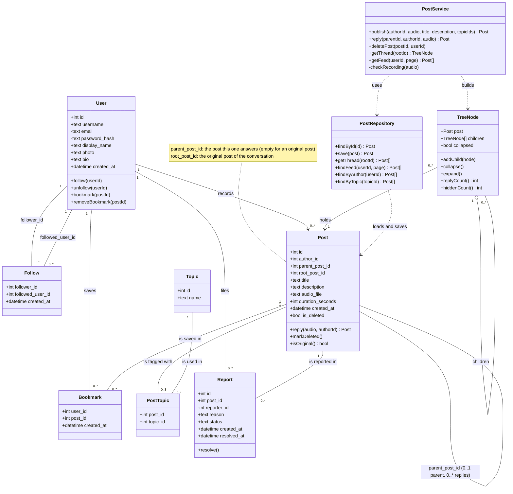
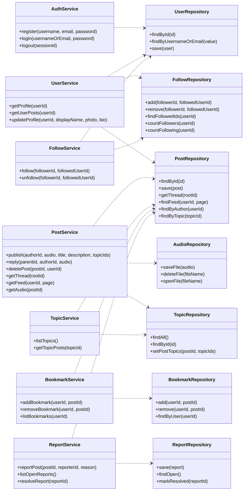

# Class diagram

This file has two class diagrams. The first shows the data VoiceThread stores, how the pieces link, and the classes that load a conversation and build it into a tree. The second lists every service and repository on the API server, with the names the component diagram (`component.md`) and the sequence diagrams use.

The data classes and their fields are the tables in section 3 of `docs/design.md`, with the same names. The types are the simple kinds of value each field holds. The exact SQLite column types are chosen when the database is built (backlog item B-01).

`+` means public and `-` means private. This is the planned design. Nothing in it is built yet.

## 1. Data model and conversation tree

## The classes

| Class | What it is | Key | Rules from the requirements |
|---|---|---|---|
| User | One account | `id` | `username` and `email` are unique (FR-01). The password is at least 8 characters and only its hash is stored (FR-01, NFR-04). `email` and `password_hash` are private (see Privacy below). |
| Post | One recording: an original post or a reply | `id` | An original post has a title and 1 to 3 topics, and its description is optional. A reply has no title or topics (FR-09). Every recording is 30 seconds to 5 minutes, at most 10 MB, and WebM, Ogg or MP4 audio (FR-10). `audio_file` is the file name in the audio folder (design section 1). |
| Topic | A subject from the fixed list | `id` | Users pick topics from the list and cannot add new ones (FR-19). |
| PostTopic | Links an original post to one of its topics | `post_id` and `topic_id` together | An original post has 1 to 3 rows and a reply has none (FR-09). |
| Follow | One user following another | `follower_id` and `followed_user_id` together | A user cannot follow themselves, so the two ids are never equal (FR-20). |
| Bookmark | A post a user has saved | `user_id` and `post_id` together | Only the user who saved it can see or remove it (FR-22, US-12). |
| Report | One user reporting one post, for the team to review by hand | `id` | Stores what the `/reports` route receives. `reason` is the user's written reason, and `status` is `open` until the team handles it, then `resolved` with `resolved_at` set. `id` is the report's ticket number. Reporting is a Sprint 3 extra (backlog B-20), not a core FR. |
| TreeNode | One post in a loaded conversation, with the replies under it | (not stored) | Built in memory when a thread is opened, never saved. It is how the thread page collapses and expands branches (FR-15, FR-17). This is the Composite pattern in `docs/architecture/patterns.md`. |
| PostService | The server logic for posts | (not stored) | Checks the rules before anything is saved, for example the recording rules (FR-10) and that only the author can delete a post (FR-11). |
| PostRepository | Loads and saves posts in the database | (not stored) | The only class that reads or writes the Post table. This is the Repository pattern in `docs/architecture/patterns.md`. |

## The methods

The methods on the data classes say what each kind of object can do. On the server, a service carries the action out and saves the result through a repository (diagram 2).

| Method | What it does | Requirement |
|---|---|---|
| `User.follow(userId)` | Follows another user. Refused if `userId` is the user's own id. | FR-20 |
| `User.unfollow(userId)` | Stops following a user. | FR-20 |
| `User.bookmark(postId)` | Saves a post to the user's private bookmarks. | FR-22 |
| `User.removeBookmark(postId)` | Removes a bookmark. | FR-22 |
| `Post.reply(audio, authorId)` | Creates a reply with `parent_post_id` set to this post and `root_post_id` set to this post's root. Refused if this post has been deleted. | FR-14 |
| `Post.markDeleted()` | Sets `is_deleted`. The row stays as a "post deleted" marker so its replies keep their place, and the audio file is removed. | FR-11, FR-18 |
| `Post.isOriginal()` | True when `parent_post_id` is empty, so the post starts a conversation. | FR-09, FR-21 |
| `Report.resolve()` | Marks the report as handled by the team. | B-20 (extra) |
| `TreeNode.addChild(node)` | Puts a reply under the post it answers while the tree is built. | FR-15 |
| `TreeNode.collapse()` | Hides every reply under this post. | FR-17 |
| `TreeNode.expand()` | Shows the replies again. | FR-17 |
| `TreeNode.replyCount()` | Counts the direct replies, shown on each post. | FR-16 |
| `TreeNode.hiddenCount()` | Counts every reply under this post, shown when the branch is collapsed. | FR-17 |
| `PostRepository.getThread(rootId)` | Loads every post with that `root_post_id` in one query. | FR-15 |
| `PostRepository.save(post)` | Saves a new or changed post, so it survives a restart. | FR-24 |
| `PostRepository.findById(id)` | Loads one post, for example the post being answered. | FR-14 |
| `PostService.getThread(rootId)` | Loads the posts through `PostRepository.getThread` and builds them into `TreeNode`s. | FR-15 |
| `PostService.publish(...)` and `PostService.reply(...)` | Check the recording with `checkRecording` before saving it. | FR-09, FR-10, FR-14 |

## 2. Services and repositories

The API server has one service for each route group in the component diagram, and one repository for each kind of stored data. A service holds the rules. A repository is the only place that reads or writes its table or folder. The dashed arrows mean "uses".

| Service | Route group | Uses | Requirements |
|---|---|---|---|
| AuthService | `/auth` | UserRepository | FR-01, FR-02, FR-03 |
| UserService | `/users` | UserRepository, PostRepository, FollowRepository | FR-04, FR-05 |
| PostService | `/posts` | PostRepository, TopicRepository, AudioRepository | FR-06 to FR-18, FR-21, FR-23, FR-25 |
| TopicService | `/topics` | TopicRepository, PostRepository | FR-19 |
| FollowService | `/follows` | FollowRepository, UserRepository | FR-20 |
| BookmarkService | `/bookmarks` | BookmarkRepository, PostRepository | FR-22 |
| ReportService | `/reports` | ReportRepository, PostRepository | B-20 (extra) |

| Repository | Reads and writes | Notes |
|---|---|---|
| UserRepository | User | Logging in looks a user up by username or email (FR-02). |
| PostRepository | Post | Also used by the profile, topic and bookmark pages to list posts. |
| TopicRepository | Topic and PostTopic | PostTopic only links posts to topics, so it has no repository of its own. |
| FollowRepository | Follow | Follower and following counts are counted here, not stored (FR-04). |
| BookmarkRepository | Bookmark | Always filtered by the logged-in user (FR-22). |
| ReportRepository | Report | Only the team reads reports. |
| AudioRepository | The audio folder | Saves, opens and deletes audio files. Deleting a post deletes its file (FR-18). |

## Privacy

- `email` and `password_hash` are private. The email is only used to log in and is never shown on a profile or in a post. Only a hash of the password is stored, never the password itself (FR-01, NFR-04).
- `Report.reporter_id` is private. The author of a reported post never sees who reported it, so users can report without fear of retaliation.

## How the conversation tree appears here

The tree is stored in the Post class itself, as section 4 of the design explains. The loop under Post is a line from Post back to Post.

- `parent_post_id` is the post this one answers. It is empty for an original post, so a post has 0 or 1 parent. A post can be answered by any number of replies, so it has 0 or more of them. The loop's label gives both numbers.
- `root_post_id` is the original post of the conversation. An original post stores its own `id` here. Every post in the conversation stores the same value, so the whole conversation can be loaded with one query. It is a second link from Post to Post, explained in the yellow note rather than drawn as a second loop, to keep the diagram readable.
- When a thread is opened, `PostService.getThread` loads those posts and builds a `TreeNode` for each one, with its replies as children. The database stores the tree as links, and `TreeNode` is the same tree in memory, ready to collapse and expand.

`is_deleted` is how a deleted post stays in the tree as a "post deleted" marker, so the replies under it keep their place (FR-18).

## Reading the lines

- The numbers at each end of a line say how many objects can be on that side. For example, one User records zero or more Posts.
- The label on a line says what the link means. Where the label is a field name, that field makes the link.
- Fields ending in `_id` hold the `id` of a row in another class. In the database these become foreign keys.
- Reply counts and follower counts are not stored. They are counted from Post and Follow when a page needs them.
- A dashed arrow means one class uses another. The white diamond on TreeNode means a node holds other nodes as its children.
