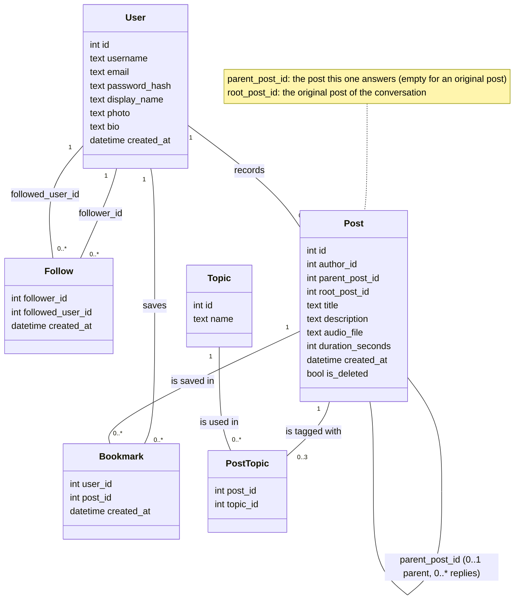

# Class diagram

This diagram shows the data VoiceThread stores and how the pieces are connected. The six classes and their fields are the tables in section 3 of `docs/design.md`, with the same names. The types are the simple kinds of value each field holds. The exact SQLite column types are chosen when the database is built (backlog item B-01).

## The classes

| Class | What it is | Key | Rules from the requirements |
|---|---|---|---|
| User | One account | `id` | `username` and `email` are unique (FR-01). The password is at least 8 characters and only its hash is stored (FR-01, NFR-04). |
| Post | One recording: an original post or a reply | `id` | An original post has a title and 1 to 3 topics, and its description is optional. A reply has no title or topics (FR-09). Every recording is 30 seconds to 5 minutes, at most 10 MB, and WebM, Ogg or MP4 audio (FR-10). `audio_file` is the file name in the audio folder (design section 1). |
| Topic | A subject from the fixed list | `id` | Users pick topics from the list and cannot add new ones (FR-19). |
| PostTopic | Links an original post to one of its topics | `post_id` and `topic_id` together | An original post has 1 to 3 rows and a reply has none (FR-09). |
| Follow | One user following another | `follower_id` and `followed_user_id` together | A user cannot follow themselves, so the two ids are never equal (FR-20). |
| Bookmark | A post a user has saved | `user_id` and `post_id` together | Only the user who saved it can see or remove it (FR-22, US-12). |

## How the conversation tree appears here

The tree is stored in the Post class itself, as section 4 of the design explains. The loop under Post is a line from Post back to Post.

- `parent_post_id` is the post this one answers. It is empty for an original post, so a post has 0 or 1 parent. A post can be answered by any number of replies, so it has 0 or more of them. The loop's label gives both numbers.
- `root_post_id` is the original post of the conversation. An original post stores its own `id` here. Every post in the conversation stores the same value, so the whole conversation can be loaded with one query. It is a second link from Post to Post, explained in the yellow note rather than drawn as a second loop, to keep the diagram readable.

`is_deleted` is how a deleted post stays in the tree as a "post deleted" marker, so the replies under it keep their place (FR-18).

## Reading the lines

- The numbers at each end of a line say how many objects can be on that side. For example, one User records zero or more Posts.
- The label on a line says what the link means. Where the label is a field name, that field makes the link.
- Fields ending in `_id` hold the `id` of a row in another class. In the database these become foreign keys.
- Reply counts and follower counts are not stored. They are counted from Post and Follow when a page needs them.
