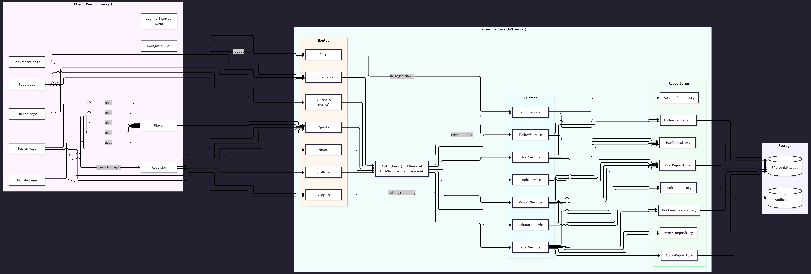
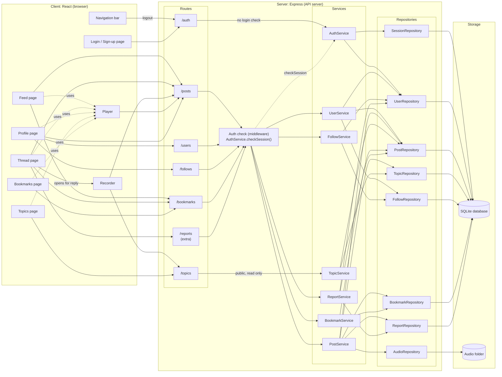

# Component diagram

This diagram shows the main parts of the system: the client pages, the API server's route groups, the login check, the services and repositories, and where data is stored. It is based on the pages and features in `requirements.md`, the data model in `design.md`, and the class names in `class.md`.

This is the planned design. Nothing in it is built yet.

## Pages and routes

| Page | Routes | FRs | Notes |
|---|---|---|---|
| Navigation bar (shared) | POST /auth/logout | FR-03 | Logout lives here once, not on every page. |
| Login / Sign-up | POST /auth/register, POST /auth/login | FR-01, FR-02, FR-03 | FR-03 mentions the login page. |
| Feed | GET /posts/feed, POST /bookmarks, DELETE /bookmarks/:postId | FR-21, FR-16, FR-22, FR-23 | Original posts only, followed users first, newest first. Copy-link will be done in the browser (no route). |
| Thread | GET /posts/:id/thread, DELETE /posts/:id, POST /bookmarks, DELETE /bookmarks/:postId, POST /reports | FR-14 to FR-18, FR-11, FR-22, FR-23, FR-25 | Reply button opens the Recorder. Delete keeps the row ("post deleted" marker, FR-18) but removes the audio file. Report sends postId and reason (extra, not a core FR). |
| Recorder | POST /posts, POST /posts/:id/replies, GET /topics | FR-06 to FR-10 | Only page that creates posts and replies. The server will check length, size and format before saving. |
| Player | GET /posts/:id/audio | FR-12, FR-13 | Used inside the Feed, Thread, Profile, Topics and Bookmarks pages. Will return the audio file, or "not found" if the post was deleted. Range requests will let the progress bar seek. |
| Profile | GET /users/:id, GET /users/:id/posts, PATCH /users/me, DELETE /posts/:id, POST /follows/:userId, DELETE /follows/:userId | FR-04, FR-05, FR-11, FR-20 | GET /users/:id/posts returns original posts only, no replies (FR-04). Edit and delete only on your own profile; the server checks this too (FR-05, FR-11, NFR-04). |
| Topics | GET /topics, GET /topics/:id/posts | FR-19 | Topic has only id and name (design.md section 3). Original posts, newest first. |
| Bookmarks | GET /bookmarks, DELETE /bookmarks/:postId | FR-22 | Only the logged-in user's bookmarks, most recent first. Users can remove a bookmark here. |

## Routes, services and repositories

Each route group has one service, and each service uses the repositories listed. The names and links are the ones in `class.md`.

| Route group | Login check | Service | Repositories it uses |
|---|---|---|---|
| /auth | No | AuthService | SessionRepository, UserRepository |
| /users | Yes | UserService | UserRepository, FollowRepository, PostRepository |
| /posts | Yes | PostService | PostRepository, AudioRepository, TopicRepository, BookmarkRepository, ReportRepository |
| /topics | No (public, read only) | TopicService | TopicRepository, PostRepository |
| /follows | Yes | FollowService | FollowRepository, UserRepository |
| /bookmarks | Yes | BookmarkService | BookmarkRepository, PostRepository |
| /reports | Yes | ReportService | ReportRepository, PostRepository, UserRepository |

AudioRepository reads and writes the audio folder. Every other repository reads and writes the SQLite database.

## Notes

- **Login check:** The auth check is middleware in front of every route group except `/auth` and `/topics`. It calls `AuthService.checkSession()`, which looks the session up through `SessionRepository` and refuses the request if the user is not logged in (FR-03, NFR-04).
- **Safety:** The `/reports` route lets users report a post with a written reason so the team can review it by hand. It is an extra feature, not a core FR, but it is part of how the architecture supports user safety. Only users with the moderator role can list and resolve reports (`ReportService.checkModerator()` in `class.md`).
- **Deleted posts:** When a post is deleted, its row will stay with a "post deleted" marker, and its audio file will be removed from the audio folder. Its bookmarks are removed and its open reports are closed, as the "Deleting a post" section of `class.md` describes.

## Mermaid source

Show the Mermaid code for this diagram

