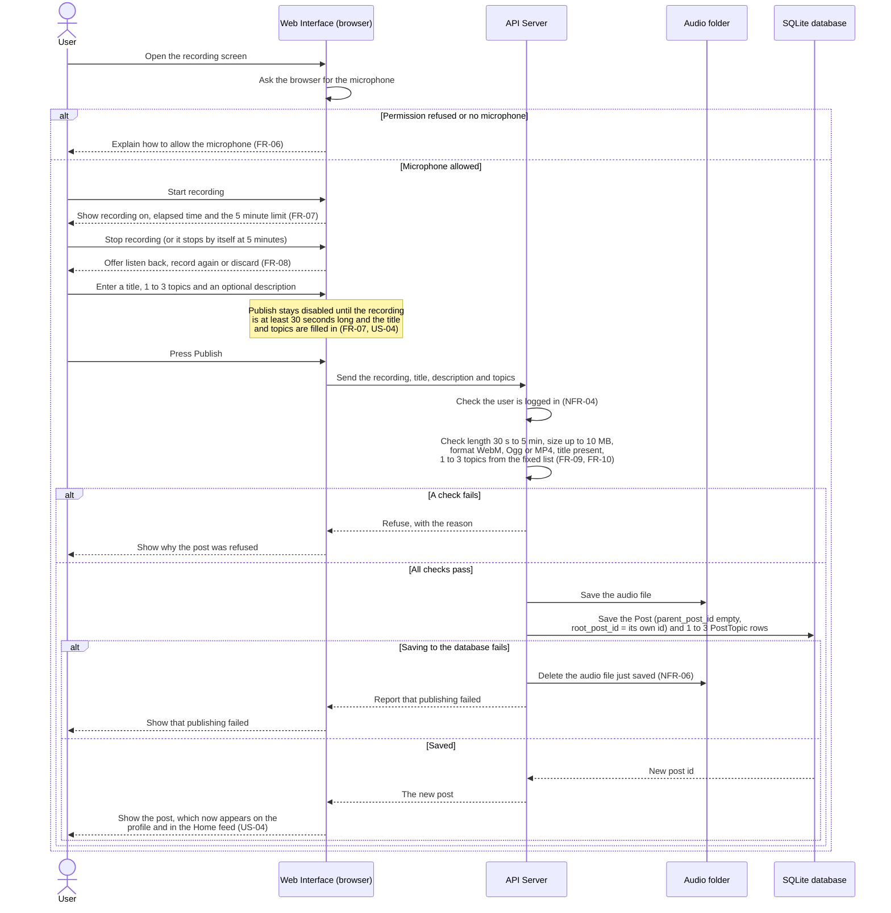

# Sequence diagram: publish an original post

This diagram shows, step by step, what happens when a user records and publishes an original post. It covers US-03 and US-04 and requirements FR-06 to FR-10.

The four parts of the system are the ones in the architecture diagram in section 2 of `docs/design.md`. The messages are written in plain words. The exact API addresses are chosen in Sprint 2.

## Notes

- Discard on the listen-back step throws the recording away and nothing is sent to the server (US-03).
- The browser already checks the length, title and topics, but the server checks everything again, because a request can be sent without using our interface. The limits are the same on both sides.
- The audio file is saved before the database row, so a post never points to a file that does not exist. If the database save fails, the file is deleted, so no orphaned audio is left behind (NFR-06).
- Not decided yet: how the server measures the length of the recording. This is settled with backlog item B-05 in Sprint 2.
