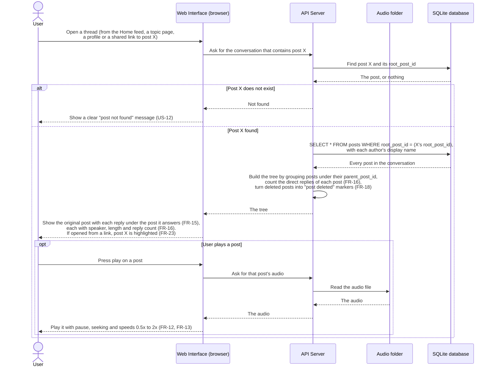

# Sequence diagram: load a conversation thread

This diagram shows how a whole conversation is loaded and shown as a tree, and how one of its posts is played. It covers US-08 and requirements FR-15, FR-16, FR-18 and FR-23, plus playback from US-06 (FR-12, FR-13). The query is the one in section 4 of `docs/design.md`.

## Notes

- One query loads the whole conversation, because every post stores the `root_post_id` of its conversation. A link can point to a reply deep in the tree, so the server first looks up that post to find its `root_post_id`.
- The tree is built in memory by grouping the posts under their `parent_post_id`. This is the adjacency list from design section 4. The design says "the app" builds it without saying which part. This diagram puts it on the server, so the browser receives a finished tree with the reply counts already worked out.
- A deleted post is sent as a "post deleted" marker without its audio or title, so the replies under it keep their place (FR-18). If a shared link points to a deleted post, the marker is highlighted, so the user sees clearly that it was deleted (US-12).
- Collapsing, expanding, and moving along branches (US-09) happen in the browser on the tree that is already loaded, so they need no extra request.
- Not decided yet: whether someone who is not logged in can open a thread. FR-03 says pages that need an account send the user to the login page, but the requirements do not list which pages those are. This diagram does not show a login check for that reason.
