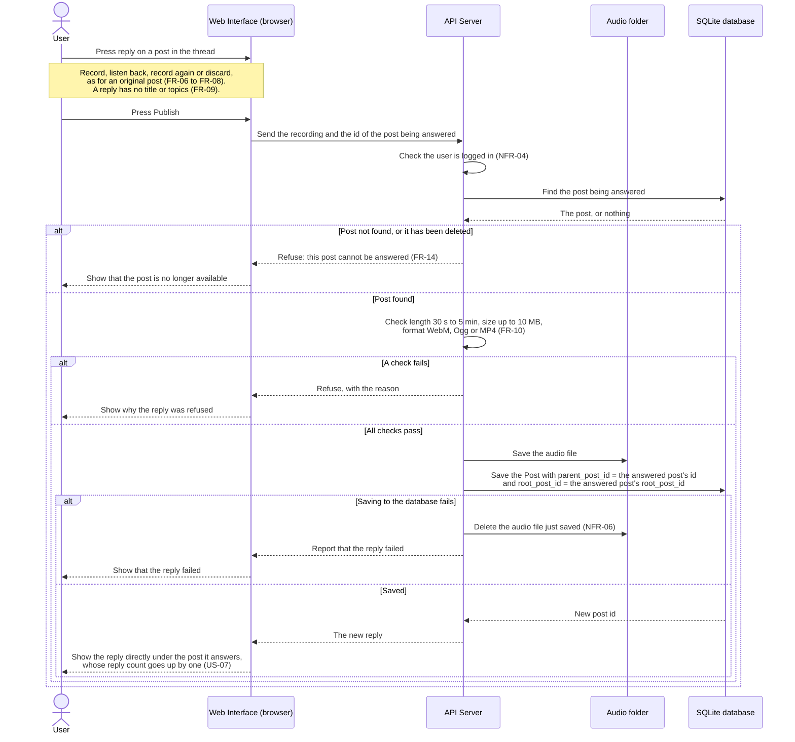

# Sequence diagram: reply with voice

This diagram shows what happens when a user answers a post with a voice reply. The post being answered can be an original post or another reply. It covers US-07 and requirements FR-09, FR-10 and FR-14, and shows how a reply is linked into the conversation tree (section 4 of `docs/design.md`).

The recording steps are the same as for an original post (see `sequence-create-post.md`), so they are shortened to one note here.

## Notes

- `parent_post_id` is what puts the reply in the right place in the tree. It points to the exact post being answered, at any depth (FR-14).
- `root_post_id` is copied from the post being answered, so the new reply belongs to the same conversation and is loaded with it.
- The server looks up the post being answered before saving anything, so no reply is ever saved without a valid parent (NFR-06), and nobody can answer a deleted post (US-07).
- The reply count is not stored. It goes up because there is now one more post whose `parent_post_id` points to that post.
