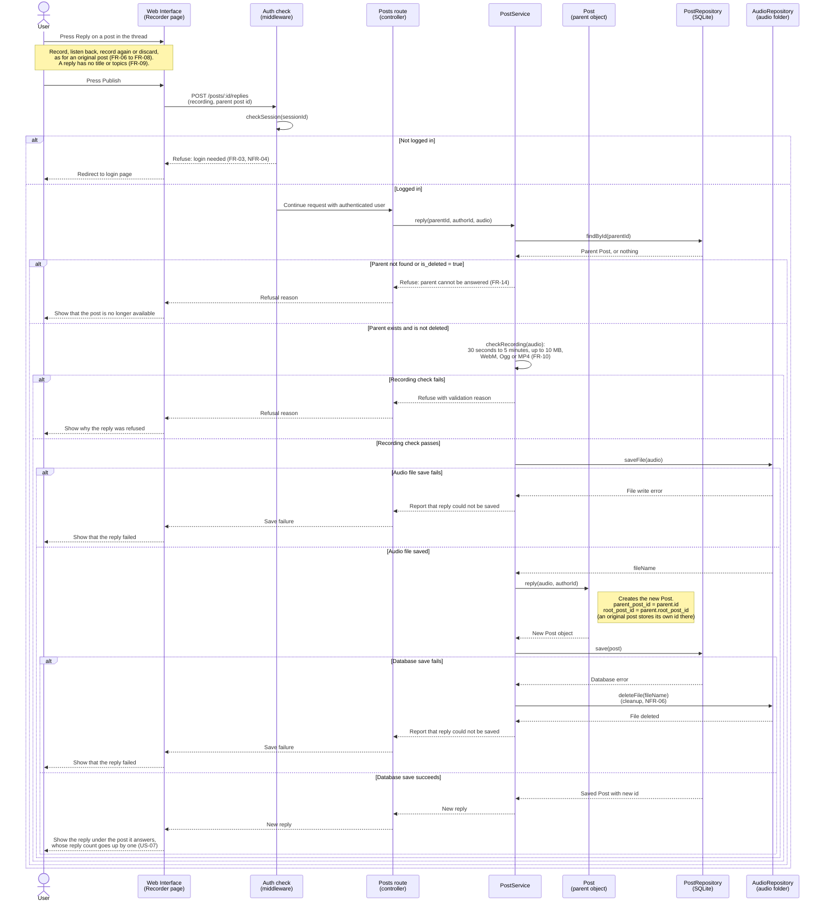

# Sequence diagram: reply with voice

This diagram shows what happens when a user answers a post with a voice reply. The post being answered can be an original post or another reply. It covers US-07 and requirements FR-09, FR-10 and FR-14, and shows how a reply is linked into the conversation tree (section 4 of `docs/design.md`).

The server flow is split into the auth middleware, Posts route (controller), `PostService`, the parent `Post` object, `PostRepository` and `AudioRepository`. The middleware authenticates the request before it reaches the route. Every class and method name below is the one in `class.md`, and the route is the one in `component.md`.

The recording steps are the same as for an original post (see `sequence-create-post.md`), so they are shortened to one note here.

This is the planned design. Nothing in it is built yet.

## Who does what

| Part | What it does in this flow |
|---|---|
| Web Interface | Records the reply and sends it, then shows the result |
| Auth check (middleware) | Checks the session before the request reaches the Posts route; redirects unauthenticated users |
| Posts route (controller) | Receives the authenticated request, calls the service, and returns the result. It holds no business rules |
| `PostService` | Checks the parent and recording, coordinates file/database persistence, and cleans up a saved file if the database save fails |
| `Post` (parent object) | Creates the reply through `parent.reply(audio, authorId)` |
| `PostRepository` | Reads and writes posts in SQLite (`findById`, `save`) |
| `AudioRepository` | Saves and deletes audio files (`saveFile`, `deleteFile`) |

## Notes

- `parent_post_id` points to the exact post being answered, including when replying to another reply (FR-14).
- `root_post_id` is copied from the post being answered. An original post stores its own id as its `root_post_id` (`design.md` section 4), so every reply, at any depth, gets the id of the original post and is loaded with the rest of the conversation.
- The auth middleware runs before the controller. An unauthenticated request is refused by the middleware and does not enter `PostService` (FR-03, NFR-04).
- The audio file is saved before the post. If `saveFile` fails, the service reports the failure and does not attempt the database save. If the database save fails after the file was written, the service deletes that file to avoid an orphaned audio file (NFR-06).
- `checkRecording` is shown as a `PostService` self-call. The server-side check is authoritative (FR-10).
- Database field names remain `snake_case` (`parent_post_id`, `root_post_id`, `is_deleted`); method parameters and local variables use `camelCase` (`parentId`, `authorId`, `fileName`).
- The reply count is not stored. It increases because one more post has a `parent_post_id` pointing to the answered post.
