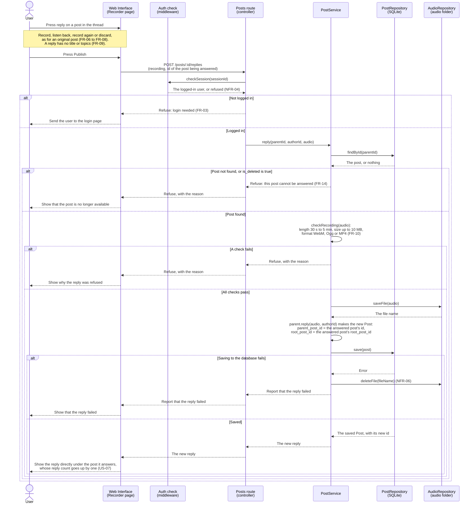

# Sequence diagram: reply with voice

This diagram shows what happens when a user answers a post with a voice reply. The post being answered can be an original post or another reply. It covers US-07 and requirements FR-09, FR-10 and FR-14, and shows how a reply is linked into the conversation tree (section 4 of `docs/design.md`).

In Sprint 1 the server was one lifeline called API Server. In Sprint 2 it is split into the parts shown in `component.md` and `class.md`: the auth check, the posts route (the controller), `PostService`, `PostRepository` and `AudioRepository`. Every class and method name below is the one in `class.md`. The route is the one in `component.md`.

The recording steps are the same as for an original post (see `sequence-create-post.md`), so they are shortened to one note here.

This is the planned design. Nothing in it is built yet.

## Who does what

| Part | What it does in this flow | Name in `class.md` or `component.md` |
|---|---|---|
| Web Interface | Records the reply and sends it, then shows the result | Recorder page |
| Auth check | Runs before the route and refuses anyone who is not logged in | `AuthService.checkSession(sessionId)` |
| Posts route (controller) | Receives the request, passes it to the service, and sends the answer back. It holds no rules | `POST /posts/:id/replies` |
| `PostService` | Holds the rules: the parent must exist and not be deleted, the recording must pass the checks, and the audio and the post are saved together | `PostService.reply(parentId, authorId, audio)` |
| `PostRepository` | The only place that reads and writes the posts table in SQLite | `findById`, `save` |
| `AudioRepository` | The only place that reads and writes the audio folder | `saveFile`, `deleteFile` |

## Notes

- `parent_post_id` is what puts the reply in the right place in the tree. It points to the exact post being answered, at any depth (FR-14).
- `root_post_id` is copied from the post being answered, so the new reply belongs to the same conversation and is loaded with it.
- `PostService` looks up the post being answered before saving anything, so no reply is ever saved without a valid parent (NFR-06), and nobody can answer a deleted post (US-07). `Post.reply` also refuses a deleted post.
- The audio file is saved before the post. If saving the post fails, `PostService` deletes the file it just saved, so a failed reply leaves no half-saved post and no unused audio file (NFR-06).
- `checkRecording` is private to `PostService` (the `-` in `class.md`). The browser checks length and format too, to give quick feedback, but the server check is the one that counts (FR-10).
- The reply count is not stored. It goes up because there is now one more post whose `parent_post_id` points to that post.
