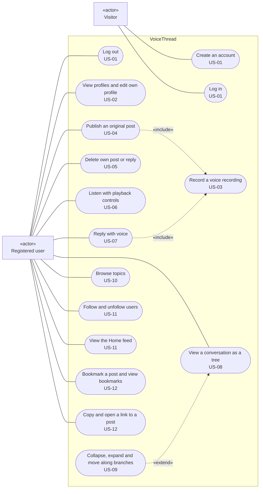

# Use case diagram

This diagram shows who uses VoiceThread and what they can do with it. Each use case comes from a user story in `docs/requirements.md`, and the story ID is written under its name.

The two actors are the ones in section 2 of the requirements. A visitor has no account yet. A registered user is the listener and the contributor from that section: the same person, listening at one moment and recording at another, so they are one actor here.

Search, the Discover page, and reporting a post are left out because they are Sprint 3 extras that are built only if time allows (requirements section 4).

## How to read it

- A solid line joins an actor to a use case they can start.
- «include» means the use case always does the other one as part of it. Publishing an original post and replying both start by recording, so recording is drawn once and shared.
- «extend» means the use case adds optional behaviour to another. Collapsing, expanding, and moving along branches only happen while a conversation tree is open.
- Mermaid, the tool GitHub uses to draw these diagrams, has no special use case shapes. The actors are drawn as boxes marked «actor» and the use cases as rounded shapes inside the VoiceThread boundary.

## Use cases and requirements

| Use case | User story | Functional requirements |
|---|---|---|
| Create an account | US-01 | FR-01 |
| Log in | US-01 | FR-02 |
| Log out | US-01 | FR-03 |
| View profiles and edit own profile | US-02 | FR-04, FR-05 |
| Record a voice recording | US-03 | FR-06, FR-07, FR-08 |
| Publish an original post | US-04 | FR-07, FR-09, FR-10 |
| Delete own post or reply | US-05 | FR-11, FR-18 |
| Listen with playback controls | US-06 | FR-12, FR-13 |
| Reply with voice | US-07 | FR-09, FR-10, FR-14 |
| View a conversation as a tree | US-08 | FR-15, FR-16, FR-18 |
| Collapse, expand and move along branches | US-09 | FR-17, FR-25 |
| Browse topics | US-10 | FR-19 |
| Follow and unfollow users | US-11 | FR-20 |
| View the Home feed | US-11 | FR-21 |
| Bookmark a post and view bookmarks | US-12 | FR-22 |
| Copy and open a link to a post | US-12 | FR-23 |

FR-24 (everything is still there after a refresh or a restart) is not a use case of its own. It applies to every use case that saves something.
