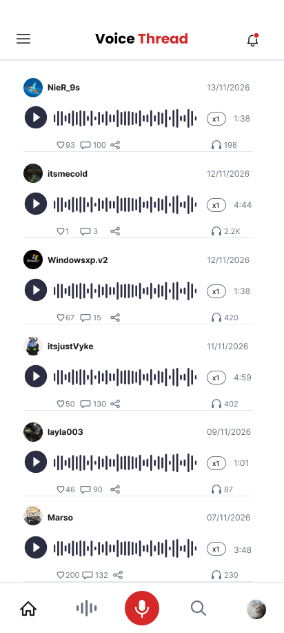
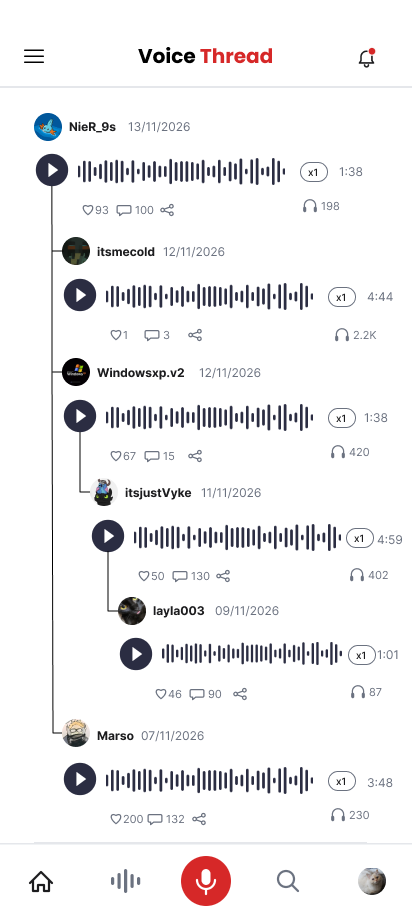
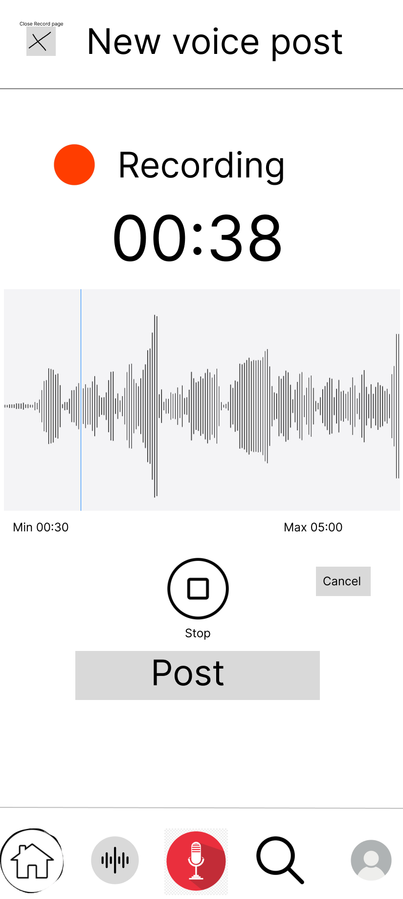
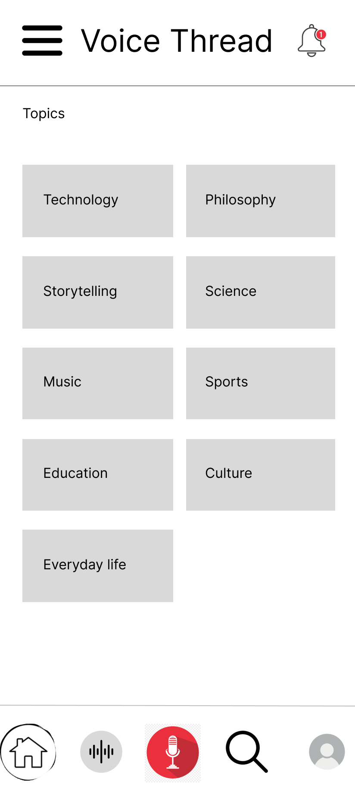
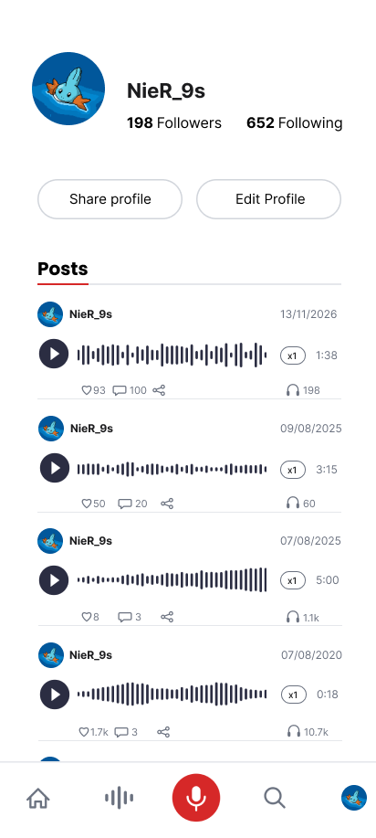

# Wireframes

> **Status:** Sprint 2. High-fidelity phone screens, plus the full set of mid-fidelity screens.
> **Owner:** Rayyan (Package 4).

These are the Sprint 2 wireframes of the VoiceThread phone layout. They were drawn in Figma at 412 by 917 pixels and exported as PNG files. The high-fidelity screens use the app's colours: a red accent, navy play buttons and waveforms, and grey dividers.

**Figma design:** https://www.figma.com/design/CKYiVGtwJllHe7USKXzevC/Wireframes

**Figma prototype:** https://www.figma.com/proto/CKYiVGtwJllHe7USKXzevC/Wireframes?node-id=12-902&starting-point-node-id=12%3A902

## Main screens

| Screen | File | Requirements covered | What changed since Sprint 1 |
|---|---|---|---|
| Home feed | `01-home-feed.png` | FR-16, FR-21, FR-22, FR-23 | Now high fidelity, in the app's colours. Each post now shows its date and real numbers for likes, replies and listens instead of placeholder boxes. The bookmark icon was taken out of the row under each post. |
| Thread view | `02-thread-view.png` | FR-15, FR-16, FR-17, FR-18, FR-25 | Now high fidelity. The same tree layout, with the connecting lines, now shows each post's date and real counts. |
| Recording | `03-recording.png` | FR-06, FR-07, FR-08, FR-09 | Still mid fidelity (grey). Adds a Max 05:00 marker next to the Min 00:30 marker. New screens in `grey/` cover recording a reply, reviewing the recording, reaching the 5-minute limit and confirming before publishing. |
| Topics | `04-topics.png` | FR-19 | New in Sprint 2. Still mid fidelity (grey). Shows the fixed list of topics as tiles. |
| Profile | `05-profile.png` | FR-04, FR-05, FR-11, FR-20 | Now high fidelity, with real follower and following counts and dated posts. The three icons next to the Posts heading were removed. |
| Another user's profile | `06-other-profile.png`, `07-other-profile-following.png` | FR-04, FR-20 | Now its own screen, in two states. The single Follow/Following button became a large Follow button, which changes to Following and Share profile once you follow the user. |
| Followers | `08-followers.png` | FR-04, FR-20 | New in Sprint 2. Followers and Following tabs, a search box, and a Follow or Following button next to each person. |
| Search | `09-search.png` | B-18 (extra) | New in Sprint 2. A back button and a search box over the feed. |

Recording and Topics are still mid fidelity. Colour versions are planned.

## All screens

The full set of 25 mid-fidelity screens is in [grey/](grey/), numbered in the order a user moves through the app: welcome, log in and sign up, the home feed and thread view, recording a post or reply, topics, search, activity, the side menu, bookmarks, settings, editing the profile, changing the password, the terms and privacy pages, and the profile screens.

The Sprint 1 low-fidelity wireframes are kept in [archive-sprint-1/](archive-sprint-1/).

## Changes from the Sprint 1 wireframes

- Login with Google was removed. Log in and sign up use a username or email and a password only.
- The screens Sprint 1 did not draw were added: topics, search, followers, activity, the side menu, bookmarks, settings, editing the profile, changing the password, and the terms and privacy pages.
- Recording now has its own screens for reviewing the recording, reaching the 5-minute limit and confirming before a post is published.

## Screen previews

### Home feed

### Thread view

### Recording

### Topics

### Profile

