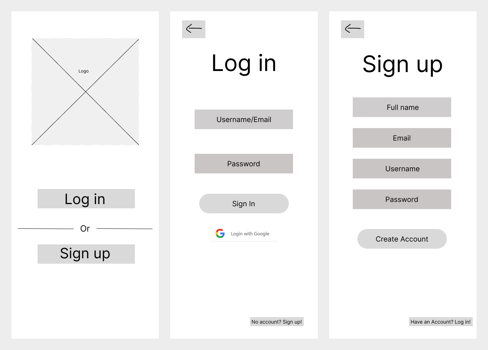
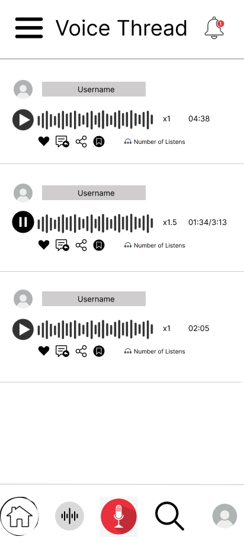
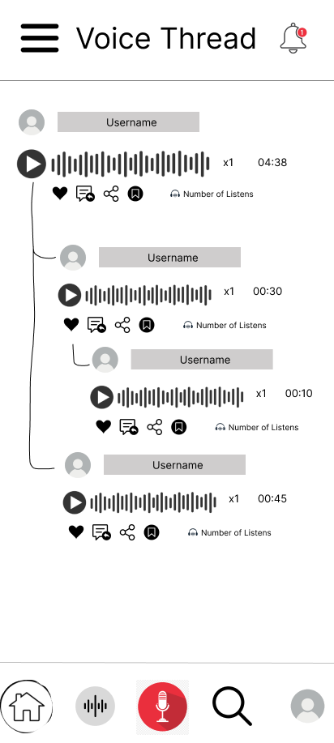
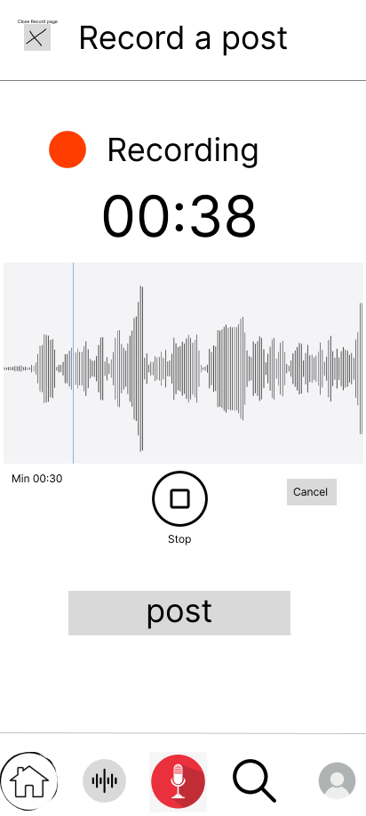
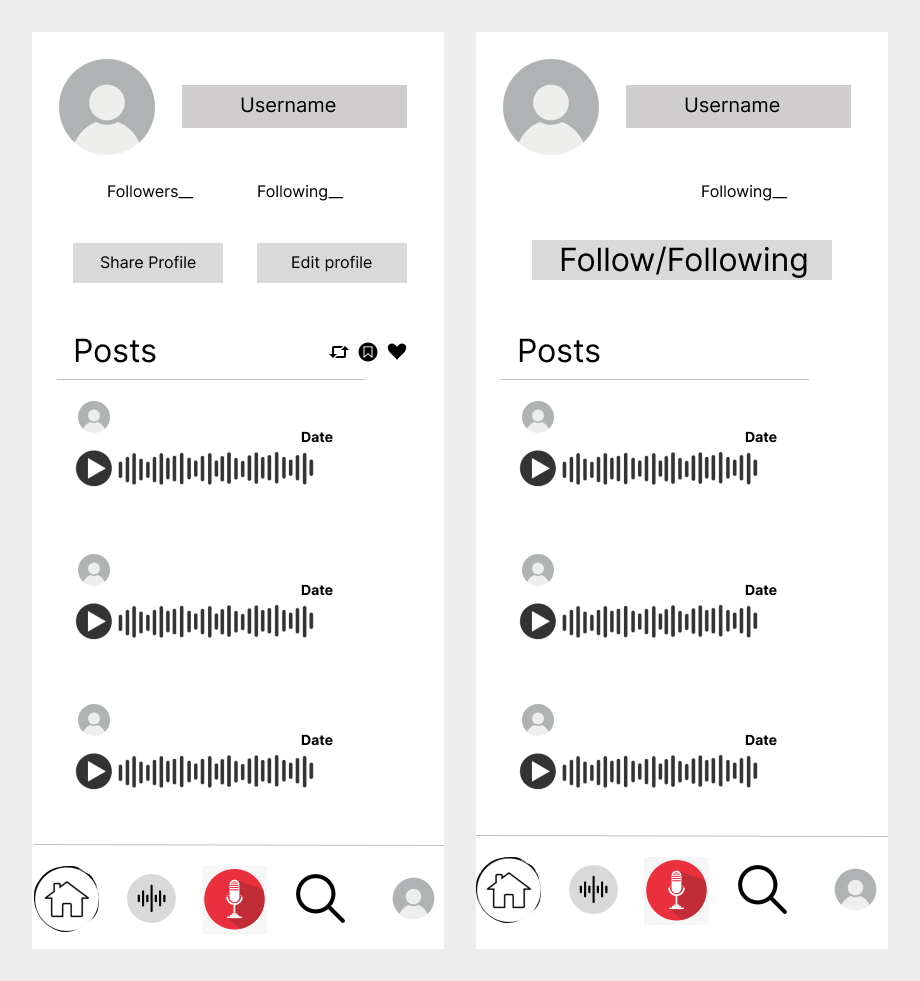

# Wireframes

> **Status:** phone layout drawn for the five screens. Desktop layouts are planned for Sprint 2 (backlog item B-02).
> **Owner:** Package 4.

These are low-fidelity wireframes of the phone layout of the VoiceThread web app. They were drawn in Figma at 412 by 917 pixels and exported as PNG files.

**Figma file:** https://www.figma.com/design/CKYiVGtwJllHe7USKXzevC/Wireframes

| # | Screen | File | What it shows |
|---|---|---|---|
| 1 | Login and registration | `01-login.png` | The welcome page, the log in form and the sign up form, side by side. |
| 2 | Home feed | `02-home-feed.png` | A list of voice posts, each with its speaker, player and action icons. |
| 3 | Thread view (the conversation tree) | `03-thread-view.png` | An original post with replies indented under the post they answer, on three levels. |
| 4 | Recording a post or a reply | `04-recording.png` | The recording screen while a recording is running. |
| 5 | Profile | `05-profile.png` | The user's own profile and another user's profile, side by side. |

## Notes on each screen

### 1. Login and registration

The welcome page shows the logo and two buttons. Log in opens the log in form and Sign up opens the sign up form. On the log in form the user types a username or email and a password and presses Sign In to reach the home feed, and the link at the bottom goes to the sign up form. On the sign up form the user types a full name, email, username and password and presses Create Account. The arrow at the top of both forms goes back to the welcome page.

### 2. Home feed

The home feed lists voice posts from top to bottom. Each post shows the speaker's picture and username, a play or pause button, the playback speed, and the length of the recording, or the time played so far while it is playing. The icons under a post are like, reply, share and bookmark, with the number of listens beside them. The bar at the bottom is on every screen after log in and has buttons for home, audio, recording, search and the user's profile.

### 3. Thread view

The thread view shows one conversation as a tree. The original post is at the top, each reply is indented under the post it answers and joined to it by a line, and a reply to a reply is indented one step further. Every post has its own play button, speed, length and the same icons as on the home feed, so the user can listen to any post and press its reply icon to answer that exact post.

### 4. Recording

The recording screen is shown while a recording is running. A red dot and the word Recording show that the microphone is on, with the time recorded so far in large numbers and a live sound wave under it. The "Min 00:30" label marks the shortest recording that can be posted. Stop ends the recording, Cancel throws it away, the post button publishes it, and the cross at the top closes the screen.

### 5. Profile

The left frame is the user's own profile, with the picture, username, follower and following counts, and the Share Profile and Edit profile buttons. Under them is the list of the user's posts, each with a play button and its date, and the three icons next to the Posts heading are for reposts, bookmarks and likes. The right frame is another user's profile, where a Follow or Following button takes the place of the two buttons and the three icons are not shown.

## Differences from the requirements

These wireframes are a first version, so they do not fully match `docs/requirements.md` yet. The differences are listed here so the next version, the desktop layouts in backlog item B-02, can follow the requirements.

Shown here but not in the requirements:

- Login with Google.
- Likes, reposts, the number of listens and the notification bell.
- Share Profile on the user's own profile.
- A search button in the bottom bar. Search is a Sprint 3 extra.
- Sound waves on every post. Waveform previews are out of scope, so a plain progress bar would replace them.

In the requirements but not drawn yet:

- The title and topics of an original post, on the home feed, the thread view and the recording screen.
- The number of replies on each post and a control to collapse a branch in the thread view.
- The 5 minute limit and the listen back and record again step on the recording screen.
- The display name and bio on the profile, and a delete control on the user's own posts.
- The topics page and the error messages on the forms.
